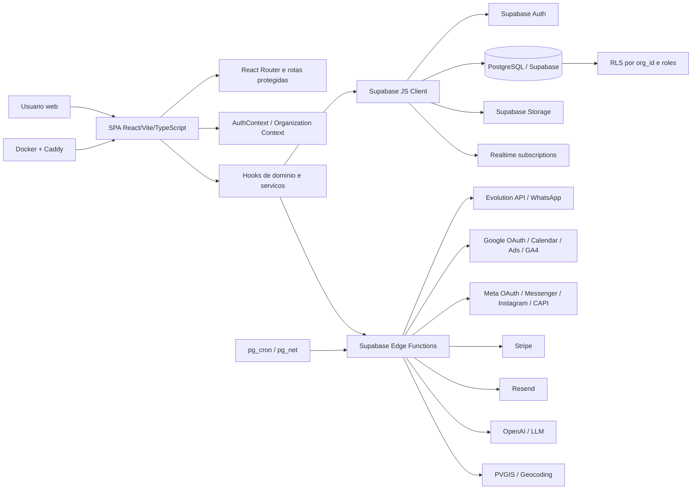
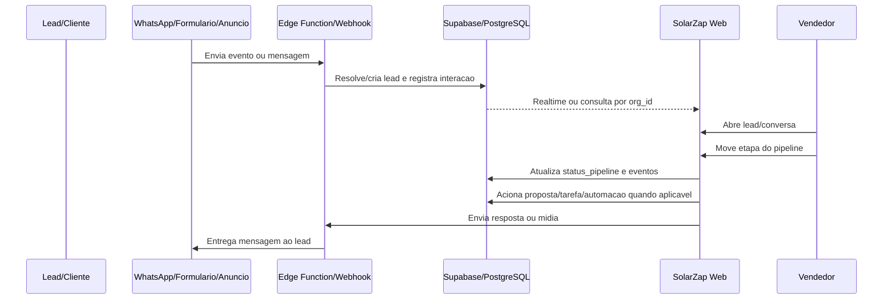
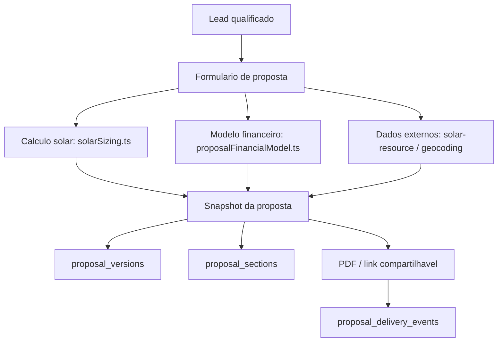
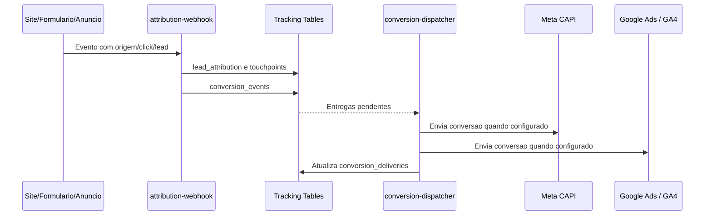
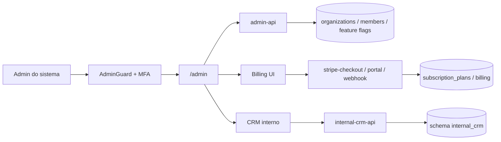

# Arquitetura e Modelagem - SolarZap

## Descricao da arquitetura

O SolarZap segue uma arquitetura web moderna baseada em SPA no front-end e backend serverless/managed no Supabase. A aplicacao React/TypeScript concentra interface, navegacao, estado de tela e chamadas a dados. O Supabase fornece autenticacao, banco PostgreSQL, RLS, realtime, storage e Edge Functions. Integracoes externas ficam encapsuladas em funcoes serverless para evitar que credenciais sensiveis sejam usadas diretamente no navegador.

Principais evidencias:

- Rotas e providers: `src/App.tsx`.
- Cliente Supabase: `src/lib/supabase.ts`.
- Autenticacao e multiorganizacao: `src/contexts/AuthContext.tsx`.
- Protecao de rotas: `src/components/ProtectedRoute.tsx`.
- Modulos CRM: `src/components/solarzap/`.
- Hooks de dominio: `src/hooks/domain/`.
- Backend serverless: `supabase/functions/`.
- Schema/migrations: `supabase/migrations/`.
- Deploy: `Dockerfile`, `docker-compose.vps.yml`, `Caddyfile`.

## Diagrama Mermaid da arquitetura geral

## Diagrama Mermaid dos principais fluxos

### Fluxo de lead, conversa e pipeline

### Fluxo de proposta comercial

### Fluxo de tracking e conversao

### Fluxo de administracao e billing

## Diagrama Mermaid ER simplificado

O diagrama abaixo e uma representacao simplificada e inferida das entidades principais observadas no codigo e migrations. Ele nao substitui o DDL completo do banco.

```mermaid
erDiagram
    USERS ||--o{ ORGANIZATION_MEMBERS : "participa"
    ORGANIZATIONS ||--o{ ORGANIZATION_MEMBERS : "possui"
    ORGANIZATIONS ||--o{ LEADS : "agrupa"
    ORGANIZATIONS ||--o{ WHATSAPP_INSTANCES : "configura"
    ORGANIZATIONS ||--o{ AUTOMATION_SETTINGS : "define"
    ORGANIZATIONS ||--o{ USER_INTEGRATIONS : "integra"

    LEADS ||--o{ INTERACOES : "registra"
    LEADS ||--o{ APPOINTMENTS : "agenda"
    LEADS ||--o{ LEAD_TASKS : "possui"
    LEADS ||--o{ PROPOSTAS : "recebe"
    LEADS ||--o{ LEAD_ATTRIBUTION : "origem"
    LEADS ||--o{ CONVERSION_EVENTS : "converte"

    PROPOSTAS ||--o{ PROPOSAL_VERSIONS : "versiona"
    PROPOSAL_VERSIONS ||--o{ PROPOSAL_SECTIONS : "compoe"
    PROPOSAL_VERSIONS ||--o{ PROPOSAL_DELIVERY_EVENTS : "entrega"

    LEAD_ATTRIBUTION ||--o{ ATTRIBUTION_TOUCHPOINTS : "detalha"
    CONVERSION_EVENTS ||--o{ CONVERSION_DELIVERIES : "despacha"

    ORGANIZATIONS ||--o{ BROADCAST_CAMPAIGNS : "executa"
    BROADCAST_CAMPAIGNS ||--o{ BROADCAST_RECIPIENTS : "envia"

    ORGANIZATIONS ||--o{ CONTRACT_DRAFTS : "cria"
    CONTRACT_DRAFTS ||--o{ CONTRACT_EVENTS : "audita"
    CONTRACT_DRAFTS ||--o{ CONTRACT_ARTIFACTS : "gera"

    INTERNAL_CRM_CLIENTS ||--o{ INTERNAL_CRM_CLIENT_CONTACTS : "possui"
    INTERNAL_CRM_CLIENTS ||--o{ INTERNAL_CRM_DEALS : "negocia"
    INTERNAL_CRM_DEALS ||--o{ INTERNAL_CRM_DEAL_ITEMS : "inclui"
    INTERNAL_CRM_DEALS ||--o{ INTERNAL_CRM_TASKS : "gera"
    INTERNAL_CRM_DEALS ||--o{ INTERNAL_CRM_APPOINTMENTS : "agenda"
    INTERNAL_CRM_DEALS ||--o{ INTERNAL_CRM_STAGE_HISTORY : "historico"
    INTERNAL_CRM_DEALS ||--o{ INTERNAL_CRM_AUTOMATION_RUNS : "aciona"
```

## Explicacao da modelagem de dados

### Multiempresa e controle de acesso

A base do sistema e a relacao entre usuarios e organizacoes:

- `organizations`: representa empresas/clientes do SolarZap.
- `organization_members`: associa usuarios a organizacoes e define papeis.
- `org_id`: aparece como chave de isolamento em diversas tabelas.
- Politicas RLS garantem que consultas e operacoes respeitem escopo de organizacao.

Evidencias: `20260218_m1_organizations_foundation.sql`, `20260218000002_m3_rls_org_scoped.sql`, `AuthContext.tsx`, `ProtectedRoute.tsx`.

### CRM principal

O modelo de CRM gira em torno de `leads` e entidades associadas:

- `leads`: dados de contato, origem, pipeline, responsavel, dados solares e status de IA.
- `interacoes`: historico de mensagens e eventos de conversa.
- `appointments`: compromissos, chamadas e visitas.
- `lead_tasks`: tarefas comerciais.
- `propostas` e tabelas de proposta: geracao, versionamento e entrega.

Evidencias: `src/types/solarzap.ts`, `src/lib/supabase.ts`, `useLeads.ts`, `useChat.ts`, `usePipeline.ts`, migrations de propostas e calendario.

### Automacoes e IA

As automacoes se apoiam em configuracoes por organizacao e em filas/jobs:

- `automation_settings`: preferencias de automacao do CRM principal.
- `ai_settings`, `ai_action_logs`, `scheduled_agent_jobs`: configuracoes e execucao de agentes de IA.
- No CRM interno, `internal_crm.automation_settings`, `automation_rules` e `automation_runs` estruturam regras e execucoes.

Evidencias: `AutomationContext.tsx`, `20260312101000_automation_settings_persistence.sql`, `20260329181000_internal_crm_arkan_blueprint.sql`.

### Tracking

O tracking usa um modelo orientado a evento:

- `org_tracking_settings`: configuracoes por organizacao.
- `ad_platform_credentials`: credenciais ou referencias seguras de plataformas.
- `lead_attribution`: origem atribuida ao lead.
- `attribution_touchpoints`: pontos de contato.
- `conversion_events`: eventos de conversao.
- `conversion_deliveries`: entregas a plataformas externas.

Evidencias: `20260304170000_tracking_v3_schema.sql`, `attribution-webhook`, `conversion-dispatcher`, `useTrackingData.ts`.

### CRM interno

O schema `internal_crm` modela a operacao interna do produto:

- Clientes e contatos.
- Produtos e precos.
- Deals, itens de deal e historico de etapas.
- Tarefas e compromissos.
- Inbox, mensagens e instancias WhatsApp.
- Campanhas e destinatarios.
- Automacoes, jobs de IA e logs.
- Ordens, assinaturas, eventos de pagamento e snapshot de app do cliente.

Evidencias: `20260328000100_internal_crm_schema_base.sql`, `20260328000450_internal_crm_inbox_campaigns_ai.sql`, `20260328000460_internal_crm_finance_snapshot.sql`, `src/modules/internal-crm/types/index.ts`.

### Contratos

O modulo de contratos registra:

- Rascunhos/minutas.
- Eventos de mudanca de estado.
- Artefatos gerados.
- Sessoes embed/publicas.

Evidencias: `src/modules/contracts/lib/schema.ts`, `src/modules/contracts/lib/repository.ts`, `20260416000100_contract_module_foundation.sql`, `20260416000200_contract_embed_sessions.sql`.

## Explicacao do fluxo de dados

1. O usuario autenticado opera a interface React.
2. A interface usa hooks para consultar e alterar dados no Supabase.
3. Consultas diretas ao banco respeitam RLS e `org_id`.
4. Operacoes com APIs externas sao delegadas a Edge Functions.
5. Edge Functions usam variaveis de ambiente/segredos do backend e gravam resultados no banco.
6. Realtime e recarregamentos incrementais atualizam a interface.
7. Jobs agendados processam notificacoes, automacoes, conversoes e tarefas de IA.
8. Relatorios e dashboards consolidam dados operacionais.

## Pontos de arquitetura pendentes de confirmacao

- Diagrama de deploy em producao real, dominio e infraestrutura ativa.
- Politica operacional de backup e retencao de dados.
- Monitoramento/logging externo alem dos registros internos.
- DDL consolidado das tabelas historicas do CRM principal.
- Estado atual das credenciais e integracoes em ambiente de producao.

